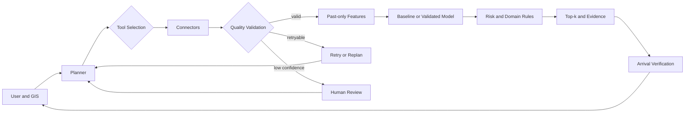

# 智慧停車 AI Agent 設計

## 1 Problem and Contract

輸入為目的地、抵達時間、車種、最大步行距離及偏好；輸出為 Top-k 停車候選、預測可用量或滿位風險、來源時間、模型、限制與替代方案。資料不足時系統必須 abstain 或轉人工確認，不能產生無證據建議。

## 2 Architecture



架構與 `docs/architecture.md`、`docs/flowchart.md` 及 Proposal pseudocode 使用同一狀態語意。

## 3 Components

| Component | Responsibility | Implementation |
|---|---|---|
| Connector | 取得 JSON，明確 timeout 與 HTTP error | `src/connectors/http_json.py` |
| Quality | schema、freshness、capacity bounds | `src/preprocessing/quality.py` |
| Baseline | 最近觀測 Persistence | `src/prediction/baseline.py` |
| Domain Rule | availability、full risk、distance score | `src/domain_rules/ranking.py` |
| Agent | plan、select、retry/replan、abstain、evidence | `src/agent/orchestrator.py` |
| Data QA | UCI duplicate、gap、coverage | `tools/analyze_uci.py` |

## 4 Data Contracts

### Roadside

- Entity key：`(source_type, Section_ID, PS_ID)`。
- Snapshot key：`(source_type, Section_ID, PS_ID, observed_at)`。
- 狀態聚合：依 `Section_ID`、snapshot time 分組，分別計算 0、1、2、unknown；unknown 不得當空位。
- 保存 `source_updated_at`、`ingested_at`、HTTP status、payload hash 與 raw payload path。

### Off-street

以來源與 `CarParkID`／官方 ID 為 entity key；保存 `TotalSpaces`、`AvailableSpaces`、service/full status 與 `DataCollectTime`。更新頻率目前 Unverified，以實際 timestamp 分布判定。

### Historical Capture

輪詢只追加、不覆寫；相同 snapshot key 與 payload hash 視為重送。Schema 變動、缺值、stale、capacity violation 與連線錯誤分開紀錄。至少 8 週且主要場站 coverage ≥ 90% 才進入臺中模型訓練。

## 5 Agent State Machine

1. Parse query and plan success criteria。
2. Select tool using capability and prior health。
3. Call and validate；retryable error 觸發 retry/replan。
4. 無有效來源或低信心轉 human review。
5. 以 past-only feature 執行 validated model；無模型則 baseline。
6. 每一候選使用自身 observation-quality pair 估算風險。
7. 套用硬限制、校準並 Top-k 排序。
8. 附 evidence；抵達後收集 ground truth，漂移時重新規劃。

## 6 Evaluation

- Temporal split：60/20/20，test 僅最終使用一次。
- Baseline：Persistence、Historical Median。
- Prediction：MAE、RMSE；full-risk：PR-AUC、Recall、Brier、ECE。
- Recommendation：Top-k Success、MRR、distance、coverage、abstention。
- Leakage：duplicate group 不跨 split；所有 lag/rolling/external feature 在 cutoff 前可取得。
- Ground truth：抵達後容許窗內第一筆合法觀測，無資料即 missing。
- Ablation：空間特徵、外部特徵、quality penalty、calibration、replan、planning。

## 7 Go or No-Go

Go：≥8 週歷史、coverage ≥90%、MAE 優於 Persistence ≥5%、滿位 Recall ≥0.80、Top-3 Success 改善 ≥5 個百分點、校準改善、p95 ≤3 秒。否則縮小場站、改為資訊與風險提示，或退回固定 pipeline。

## 8 How to Run and Verify

```powershell
python -m unittest discover -s tests -v
python tools/analyze_uci.py
```

Proposal 階段結果只有控制流程與資料 QA；臺中預測、推薦改善與線上 SLA 均為 Planned／Unverified。

