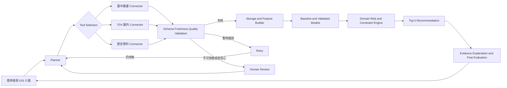

# 系統架構

本架構以可稽核的狀態機實作 Agent。Planner 依需求、資料健康度與失敗紀錄選擇工具；每次呼叫均留下 evidence，失敗時 retry 或 replan，資料不足則轉人工確認。

## Agent 狀態與責任

| 狀態 | 單一責任 | 輸出 |
|---|---|---|
| Plan | 將目的地、抵達時間、偏好拆成任務 | 有序工具計畫 |
| Select | 依來源能力與健康度選工具 | 工具名稱與參數 |
| Validate | 檢查 schema、容量邊界、時間與來源狀態 | 與 observation 綁定的 quality |
| Predict | 僅使用預測時間前可取得特徵 | 30/60 分鐘預測與風險 |
| Decide | 套用滿位、距離、費率、無障礙規則 | 候選分數 |
| Explain | 附來源時間、模型、限制與替代方案 | 可追溯建議 |
| Verify | 抵達後比對 ground truth 並監控失效 | 評估紀錄 |

原型對應 `src/agent/orchestrator.py`；工具註冊表、retry/replan 與 human review 分支均有自動化測試。

