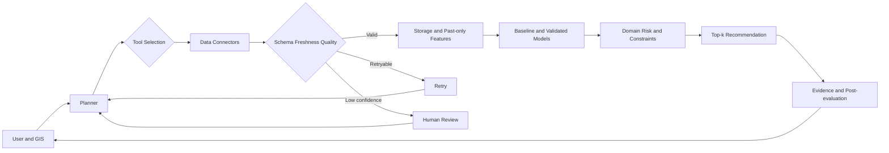
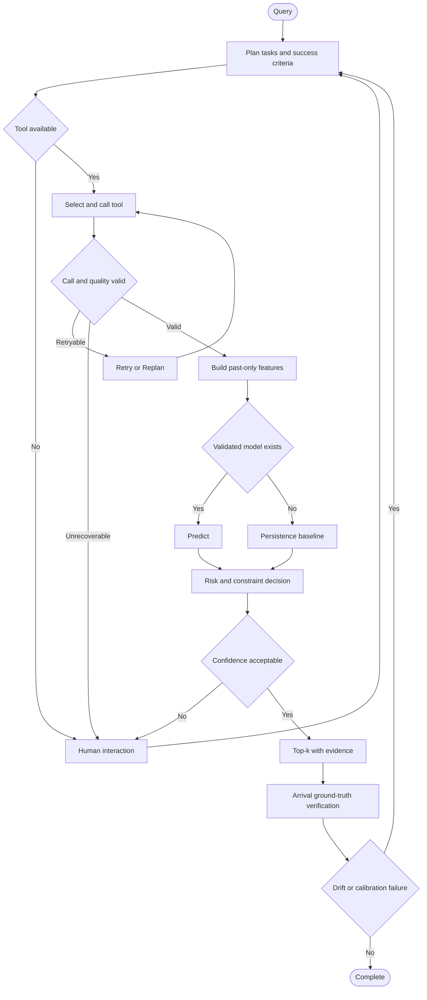

# 智慧停車 AI Agent 臺中停車可用性預測與推薦

英文題名：Smart Parking AI Agent for Availability Prediction and Recommendation in Taichung

## Abstract

**Attention Getter.** 臺中市 2025 年底登記汽車約 104.6 萬輛；停車供需與到達時間的不確定性，使駕駛即使看見即時空位，抵達時仍可能滿位 [1]。  
**But.** 現有研究分別處理路邊占用、路外場站預測與深度時空模型，但臺中公開資料分散於路邊車格、路外停車場與 TDX，資料粒度、時間戳與可靠度不同；「此刻有位」也不等於「抵達時有位」[2–4]。  
**Cure.** 本提案設計智慧停車 AI Agent，根據目的地、抵達時間與限制，自主規劃資料任務、選擇工具、驗證品質、預測滿位風險並輸出可追溯的 Top-k 建議。  
**Development.** 系統整合 API Connector、資料品質層、Persistence／歷史統計／樹模型、領域規則、Agent Orchestrator、Retry／Replan 與人工確認。  
**Experiments.** 採時間切分，與 Persistence、Historical Median 比較，以 MAE、RMSE、PR-AUC、Brier Score、校準誤差及 Top-k Success 評估；所有特徵必須在預測 cutoff 前可取得。  
**Findings.** Proposal 階段已完成可執行原型與 UCI 品質稽核；臺中歷史資料、模型效果與線上效能仍標示 Planned／Unverified，不宣稱尚未完成的結果。

## 1 Introduction

### 1.1 動機與背景

停車推薦的真正問題不是顯示目前空位，而是根據駕駛抵達時間，在資料延遲、來源失敗與空間差異下，提出仍有足夠成功機率的替代方案。臺中路邊公開資料可描述單格狀態，TDX 可提供部分路外停車場總量與可用量；兩者不能直接視為同一觀測單位 [2–4]。

### 1.2 問題定義

輸入為目的地、預計抵達時間、步行距離、車種與偏好；輸出為 Top-k 停車候選、抵達時可用量或滿位風險、資料時間、模型與限制。系統須回答：資料是否新鮮、來源失敗時如何替代、模型信心是否足以自動推薦，以及推薦抵達後是否成功。

### 1.3 研究缺口

本提案區分兩種缺口：

1. **Empirical data gap。** 尚未取得足夠長、穩定且跨路邊與路外的臺中歷史序列；此為待實證的資料缺口，不宣稱所有城市都缺資料。
2. **Project-specific integration gap。** 既有研究通常聚焦單一模型或單一資料型態 [5–12]；本專案尚需驗證多來源品質、抵達時間風險、工具失敗重規劃及可追溯推薦能否形成端到端效益。

### 1.4 研究假設

- H1：在相同時間切分下，加入過去可取得的時間與場站特徵，可使樹模型的 MAE 低於 Persistence baseline。
- H2：以校準後滿位風險排序，可提高抵達時 Top-3 至少一處可停的比例。
- H3：資料品質感知的 Agent 在 API 失敗或過期時，比固定 pipeline 產生更少無證據建議。

H1–H3 均為 Planned；只有完成臺中歷史擷取與預先定義評估後才能接受或拒絕。

### 1.5 Agent 的必要性

固定 pipeline 適合來源穩定、流程固定的批次預測；本情境需要依位置與車種選來源、根據 freshness 決定是否使用、呼叫失敗後改用替代工具、低信心時請求人工確認，並在抵達後重新驗證。若實驗顯示來源穩定且 Agent 相對固定 pipeline 無顯著效益，應採較簡單 pipeline；Agent 並非預設必勝方案。

### 1.6 貢獻與範圍

- 定義臺中路邊車格複合主鍵、狀態聚合與歷史擷取契約。
- 提出一致的 Architecture、Flowchart 與 Pseudocode。
- 建立可執行 API Connector、資料驗證、Baseline、Agent Orchestrator 及測試。
- 提供可重現 UCI 資料品質報告與完整驗證計畫。

## 2 Related Work

### 2.1 AI Technology and Domain Knowledge

停車預測研究包含統計時間到事件模型、RNN／Transformer、圖神經網路、meta-learning 與 Bayesian neural network [5–11]。深度模型可描述時空交互作用，但必須以簡單 baseline、跨時間測試與消融證明其價值。領域上，路邊單格狀態、路外可用量、抵達時間與步行成本具有不同語意，不能只因欄位相似而合併。

[11] 使用 Bayesian neural network 探討不確定性；其輸出不會自動且唯一地分離 epistemic 與 aleatoric uncertainty，因此本專案只把 freshness、模型分散度與校準誤差視為不同風險 proxy，不宣稱完成理論分解。

### 2.2 Article Summary

| Ref. | Year | Problem | Method | Domain or Dataset | Finding Used | Limitation for This Project |
|---|---:|---|---|---|---|---|
| [5] | 2024 | 都市停車預測綜述 | Review | 多城市 | 模型須依資料與 horizon 選擇 | 非臺中實證 |
| [6] | 2025 | 路邊可用性 | Dynamic graph attention | 路邊時空網路 | 圖關係可改善預測 | 需穩定歷史與鄰接資訊 |
| [7] | 2025 | 路邊占用 | Multi-view graph attention | 地理、可達性、POI | 多視角空間特徵有價值 | 移轉至臺中尚未驗證 |
| [8] | 2025 | 單格占用時間 | Time-to-event、semi-Markov | Melbourne | duration model 優於基準 | 城市與感測條件不同 |
| [9] | 2026 | 路外占用 | LSTM、Transformer、SHAP | Athens | 多來源與 horizon 影響效果 | 只涵蓋少數場站 |
| [10] | 2025 | 跨區域預測 | Meta-learning | 58 個停車區 | 小樣本移轉具有潛力 | 實作與成本較高 |
| [11] | 2025 | 不確定性 | Bayesian neural network | 停車資料 | 可提供預測分散資訊 | 不等於自動分離兩類不確定性 |
| [12] | 2025 | 都市停車管理 | Digital twin、STID | Caserta | 整合 IoT 與決策流程 | 資料與部署條件不同 |
| [13] | 2017 | 歷史占用資料 | Dataset | Birmingham 30 場站 | 可用於原型與 QA | 2016 舊資料、非臺中 |

## 3 Deep Research

### 3.1 Five Mindsets

1. **資料品質先於模型複雜度。** Schema、時間與容量錯誤會直接污染預測。
2. **模型必須匹配 horizon。** 30 與 60 分鐘的可預測性不可混為一談。
3. **保留空間與營運語意。** 路邊單格與路外場站應分別建模，再於推薦層比較。
4. **先勝過簡單 baseline。** 未勝過 Persistence 前不採用複雜模型。
5. **不確定性是決策輸入。** 風險、freshness、校準與限制須與推薦一起輸出。

### 3.2 Three Controversies

**爭議一：簡單模型或深度時空模型。** [6,7,9,10] 支持深度時空表示的潛力；[5,8] 顯示模型必須匹配資料與任務。共識是以相同時間切分比較；未解問題是臺中資料量是否足以支持複雜模型。

**爭議二：統一模型或路邊／路外分開。** 統一模型便於維護，但觀測單位與狀態語意不同。證據顯示路邊研究多使用單格／路段時空關係 [6–8]，路外研究多使用場站聚合量 [9]。本提案先分開預測，只在推薦層統一分數。

**爭議三：點預測或風險感知推薦。** 點預測易解釋；Bayesian 與校準方法可提供風險訊號 [11]，但不能把單一分數誤稱為完整 uncertainty decomposition。採用點預測加校準後滿位機率，並做 calibration ablation。

### 3.3 Ten Deep Questions

1. Why：為何抵達時間預測比即時空位顯示更符合使用者決策？
2. Evidence：臺中歷史資料的長度、缺口與來源穩定度是否足以訓練？
3. What-if：主要 API 失敗或時間戳過期時，Agent 應如何 replan？
4. Trade-off：較近但高滿位風險與較遠但穩定的場站如何權衡？
5. Failure case：路邊狀態碼錯誤或重複主鍵會如何污染聚合？
6. Comparison：Agent 相對固定 pipeline 的效益是否大於複雜度？
7. Leakage：哪些天氣、活動或 rolling 特徵在預測 cutoff 後才可得？
8. Transfer：Birmingham 結果能否移轉到臺中，哪些只可用於方法驗證？
9. Ground truth：如何把預計抵達時間與最近合法觀測配對？
10. Decision：何種校準、Top-k 成功率與延遲才符合 Go 條件？

## 4 Proposed AI Agent

### 4.1 Architecture



### 4.2 Flowchart



### 4.3 Pseudocode

```text
Algorithm Smart Parking AI Agent
Input: query Q, tool registry T, maximum replans K
Output: ranked recommendations R or human-review request

01 request <- Parse(Q)
02 plan <- Planner(request, T.capabilities)
03 attempts <- 0
04 while plan has task do
05     tool <- SelectTool(plan, T.health, request)
06     try raw <- tool.Call()
07     catch retryable error:
08         LogEvidence(error)
09         if attempts < K then plan <- Replan(plan, error); attempts <- attempts + 1; continue
10         else return RequestHumanReview(error)
11     observations <- ValidateSchemaTimeCapacity(raw)
12     if observations is empty then
13         if AlternativeToolExists(T) then plan <- Replan(plan, quality_failure); continue
14         else return RequestHumanReview(quality_failure)
15 predictions <- empty list
16 for each observation o in observations do
17     features <- BuildPastOnlyFeatures(o, request.arrival_time)
18     model <- SelectValidatedModel(o.facility_type, request.horizon)
19     forecast <- model.Predict(features) if model exists else Persistence(features)
20     forecast <- ApplyCapacityBounds(forecast, o.total_spaces)
21     forecast.risk <- EstimateFullRisk(forecast, o.quality)
22     Append(predictions, forecast)
23 scored <- ApplyDomainConstraints(predictions, request)
24 R <- CalibrateAndRankTopK(scored)
25 if ConfidenceTooLow(R) then return RequestHumanReview(R.evidence)
26 AttachSourcesTimestampsErrorsLimits(R)
27 LogForArrivalVerification(Q, observations, R)
28 return R
```

第 21 行明確使用每一筆 `o.quality`，避免把最後一個候選的品質套用到全部候選；此不變量由自動化測試驗證。

## 5 Data Design and Quality

### 5.1 臺中路邊車格

- 主鍵：`(source_type, Section_ID, PS_ID)`；`PS_ID` 單獨不唯一。
- Snapshot 唯一鍵：`(source_type, Section_ID, PS_ID, observed_at)`。
- 聚合：每個 `Section_ID` 與 snapshot time 分別計算狀態 0、1、2 與 unknown 數量；不得把 unknown 當空位。
- 歷史擷取：固定間隔輪詢，保存 source timestamp、ingested_at、HTTP 狀態、payload hash 與原始檔；逾期、重送或 schema 變動另記旗標，不覆寫原始紀錄。
- 2026-11-08 抽樣驗證：10,143 車格、367 路段；`PS_ID` 僅 391 個不同值，複合鍵 10,143 個皆唯一；狀態 0 為 2,733、狀態 1 為 7,410、狀態 2 為 0。此為單次 snapshot，不是歷史成效。

### 5.2 路外與更新頻率

臺中路外資料欄位與 TDX availability schema 已確認，但固定更新頻率尚未由官方 metadata 與長時間戳序列共同證實，因此標示 **Unverified**。實作時以連續 `DataCollectTime` 實測分布，不假設「每 10 分鐘」。

### 5.3 UCI Parking Birmingham Quality Report

可重現指令為 `python tools/analyze_uci.py`。本地 CSV 有 35,717 列、30 場站、4 欄、0 空白儲存格、216 筆完全重複；日期為 2016-10-04 至 2016-12-19，各場站 88–1,312 列。時間間隔不規則且包含跨夜缺口，不能假設完整等距序列。完整每場站覆蓋與 gap 分布存於 `data/uci_quality_report.json`。

## 6 Evaluation Plan

### 6.1 Temporal Split and Leakage Control

依時間使用 60% train、20% validation、20% test；test 僅在模型與門檻鎖定後評估一次。Rolling 與 lag feature 必須以 cutoff 前資料計算；活動與天氣只能使用當時已發布的資訊。相同 timestamp 或 duplicate group 不得跨 split。

### 6.2 Baselines and Models

Baseline 為 Persistence、同星期同時段 Historical Median；候選模型為 Random Forest／HistGradientBoosting。只有候選模型在多 horizon 與多場站穩定勝過 baseline，才把 LSTM／Transformer 納入後續實驗。

### 6.3 Full-risk Threshold and Calibration

滿位事件定義為抵達時間配對觀測的 `available_spaces = 0`。Validation set 上選擇風險門檻，使滿位 Recall 至少 0.80，並報告 Precision、PR-AUC 與成本矩陣。使用 isotonic 或 Platt scaling，以 Brier Score、Expected Calibration Error 與 reliability diagram 驗證；校準器只 fit validation，不接觸 test。

### 6.4 Arrival Ground Truth and Top-k

以預計抵達時間後容許窗內第一筆合法觀測作 ground truth；超出容許窗視為 missing，不以最近但過遠觀測填補。Top-k Success 定義為前 k 名至少一處在抵達時非滿位；另報 MRR、推薦距離、coverage 與 abstention rate。

### 6.5 Ablation

依序移除空間特徵、外部特徵、品質 penalty、校準、replan 與 Agent planning。比較固定 pipeline 與 Agent 在正常、API timeout、stale data、schema error 四種情境的有效建議率與錯誤建議率。

### 6.6 Go or No-Go

Go 條件：至少 8 週臺中歷史、主要場站有效資料 coverage ≥ 90%、候選模型 MAE 優於 Persistence ≥ 5%、滿位 Recall ≥ 0.80、Top-3 Success 優於距離排序 ≥ 5 個百分點、校準後 Brier Score 改善且 p95 回應時間 ≤ 3 秒。任一關鍵資料條件不符即 No-Go；替代方案為縮小到資料穩定場站、只提供即時資訊與風險提示，或退回固定 pipeline。

## 7 Feasibility and Status

| 項目 | Proposal 階段狀態 | 期末預定 |
|---|---|---|
| Git repository、Connector、Quality、Baseline、Agent、Tests | Implemented and Verified | 擴充正式來源與監控 |
| UCI 品質分析 | Implemented and Verified | 作方法與 QA 基準 |
| 臺中單次 API schema／數量 | Verified snapshot | 建立至少 8 週歷史 |
| 臺中預測效果與 H1–H3 | Unverified | 執行預註冊時間切分實驗 |
| GIS 介面與線上部署 | Planned | Demo 與效能測試 |

## 8 Expected Outcomes and Limitations

預期成果是可追溯的多來源停車推薦方法、Agent 失敗處理機制及嚴格評估流程。限制包括臺中長期歷史尚未建立、公開 API SLA 與更新頻率未完全證實、UCI 為舊且跨城市資料，以及 Proposal 原型只證明控制流程可執行，不代表模型已達部署品質。

## References

[1] 臺中市政府主計處，臺中市重要統計指標，2026。  
[2] 政府資料開放平臺，臺中市路邊停車格位動態資料，資料集 158166。  
[3] 政府資料開放平臺，臺中市停車場資訊，資料集 83931。  
[4] 交通部 TDX，停車場 Availability API。  
[5] C. Ma, X. Huang, and J. Li, “A review of research on urban parking prediction,” Journal of Traffic and Transportation Engineering English Edition, 11(4), 700–720, 2024. doi:10.1016/j.jtte.2023.11.004.  
[6] R. Cao, H. Chen, and D. Z. W. Wang, “An attention-based dynamic graph model for on-street parking availability prediction,” Transportation Research Part A, 193, 104391, 2025. doi:10.1016/j.tra.2025.104391.  
[7] C. Qian et al., “Curb parking occupancy prediction based on real-time fusion of multi-view spatial-temporal information using graph attention gated networks,” Applied Soft Computing, 171, 112781, 2025. doi:10.1016/j.asoc.2025.112781.  
[8] M. Schneble and G. Kauermann, “Statistical modelling of on-street parking spot occupancy in smart cities,” Journal of the Royal Statistical Society Series C, 74(4), 1128–1149, 2025. doi:10.1093/jrsssc/qlaf017.  
[9] K. Vakrinou, E. G. Mantouka, and E. I. Vlahogianni, “Leveraging multisource data for off-street parking occupancy prediction: A twofold analysis,” International Journal of Transportation Science and Technology, 21, 352–371, 2026. doi:10.1016/j.ijtst.2025.02.005.  
[10] H. Kuang et al., “Deep meta-learning approach for regional parking occupancy prediction considering heterogeneous and real-time information,” Advanced Engineering Informatics, 64, 102969, 2025. doi:10.1016/j.aei.2024.102969.  
[11] A. Nezhadettehad et al., “Uncertainty-Aware Parking Prediction Using Bayesian Neural Networks,” Sensors, 25(11), 3463, 2025. doi:10.3390/s25113463.  
[12] F. Piccialli et al., “A digital twin framework for urban parking management and mobility forecasting,” Nature Communications, 16, 9400, 2025. doi:10.1038/s41467-025-65306-w.  
[13] D. Stolfi, “Parking Birmingham,” UCI Machine Learning Repository, recommended citation 2017; repository donation 2019. doi:10.24432/C51K5Z.

